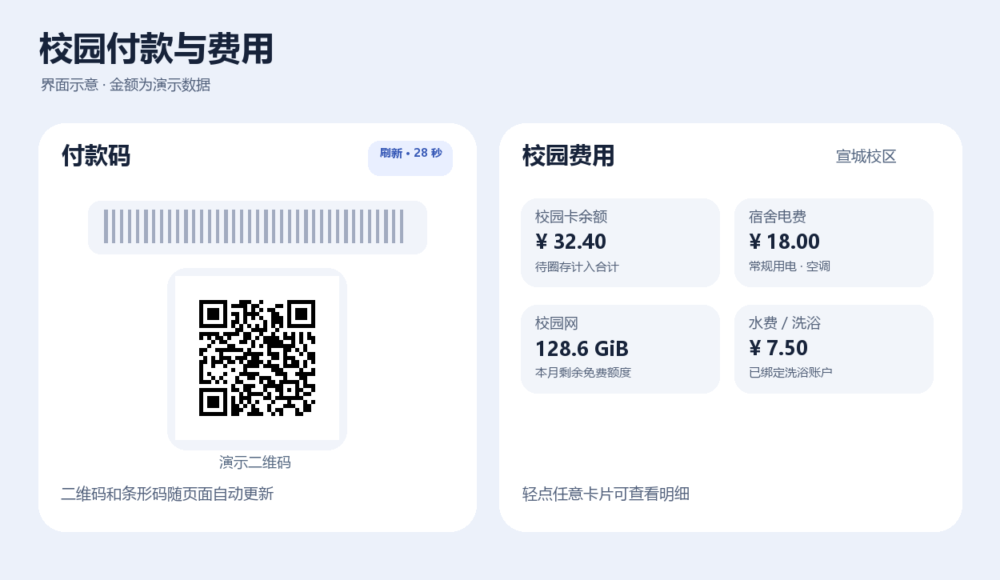
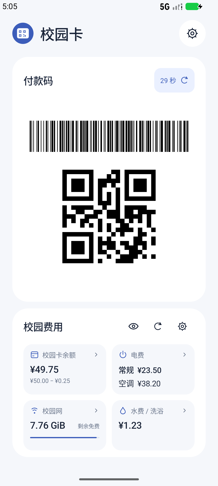

# payfor工大

一款面向合肥工业大学校园卡用户的 Android 应用。在手机上出示校园付款码，查看余额和宿舍费用。

> [!IMPORTANT]
> **非官方项目，与合肥工业大学及校园服务提供方无关。** 项目由个人维护，仅供学习、交流和自愿试用。
>
> 软件按现状提供。部分校园服务使用明文 HTTP，使用前请了解账号和付款码的传输风险。涉及扣款、到账或预圈存时，以校方账单为准。充值结果未确认时，请先核对账单。
>
> 请自行决定是否使用，并承担法律允许由使用者承担的风险。依法不得免除的责任不受本声明影响。

## 能查什么

| 功能 | 合肥校区 | 宣城校区 |
| --- | --- | --- |
| 校园付款 | 二维码、条形码 | 二维码、条形码 |
| 校园卡 | 实际余额、待圈存和合计 | 实际余额、待圈存和合计 |
| 宿舍电费 | 照明与空调 | 常规用电与空调 |
| 校园网和洗浴 | — | 流量额度、网费和洗浴余额 |

查看手机界面演示

演示截图使用虚构的余额和测试码。

校园卡余额详情可以打开支付宝校园一卡通。宣城的电费、网费和洗浴详情支持用校园卡手动充值。

## 安装

1. 在本仓库的 [Releases](../../releases) 下载 Android 安装包，手机需运行 Android 8.0 或更新版本。
2. 打开应用，登录校园卡账号。首页会显示付款码和已接入的费用项目。
3. 点「校园费用」右上角的齿轮，选择校区。查询电费时按楼栋和房间选择宿舍。宣城洗浴查询使用绑定的手机号。
4. 点费用卡片查看明细。需要遮住首页金额时，可点费用区右上角的眼睛图标。

正式构建每次进入前台时检查更新。发现新版时会弹窗提示。安装前会校验安装包及签名，更新由 Android 安装器确认。

## 隐私

在「设置 → 账户管理」可管理记住密码和自动登录。已启用使用统计的版本每天首次打开时会发送日期及当天随机生成的安装标识。统计不包含学号、余额、付款码或交易内容。完整说明见应用的「关于与隐私」。

## 从源码构建

用 Android Studio 打开当前目录，安装 Android SDK 36 和 Build Tools 35.0.0，使用 JDK 17。

~~~sh
./gradlew assembleDebug
~~~

Windows 使用 .\gradlew.bat assembleDebug。默认源码构建可直接使用。需要可选穿戴功能时，可在 Bash 中运行 bash scripts/fetch_wear_sdk.sh，再重新构建。

维护者 [dustbin1415](https://github.com/dustbin1415)。工程整理与实现由 [OpenAI Codex](https://github.com/apps/chatgpt-codex-connector) 协助。源码按 [AGPL-3.0](LICENSE) 发布，第三方组件见 [许可说明](THIRD_PARTY_NOTICES.md)。
